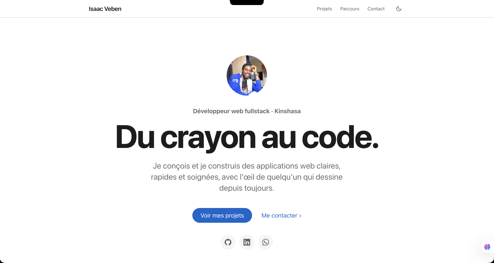

# Portfolio — Isaac Veben

Portfolio de développeur web fullstack junior, au design minimaliste inspiré d'Apple.

**[Voir le site en ligne](https://veben-cmyk.github.io/Mon_Portfolio/)**




## Contenu

Un site d'une seule page, découpé en sections :

- **Accueil** : présentation et accès direct aux projets et aux réseaux
- **Projet phare** : Kadea Chat, messagerie fullstack en temps réel
- **Autres projets** : clone de YouTube, site vitrine Coffee Shop
- **Dessins** : une sélection de portraits au crayon
- **Boîte à outils** : compétences front-end, back-end et outils
- **Parcours** : formation et expériences, avec le CV en PDF
- **Contact** : formulaire et moyens de contact directs

## Fonctionnalités

- Design responsive, pensé d'abord pour le mobile
- Mode clair et sombre, qui suit le réglage du système et mémorise le choix du visiteur
- Apparitions au scroll avec `IntersectionObserver`, désactivées si le visiteur a réduit les animations dans son système
- Effets de survol cohérents sur tout le site
- Formulaire de contact fonctionnel via Formspree
- Images compressées et chargées à la demande (`loading="lazy"`)

## Choix techniques

- **Tailwind CSS v4 compilé** : un système de design centralisé dans `@theme` (couleurs, polices). Le mode sombre redéfinit uniquement la valeur de ces variables.
- **Contenu piloté par les données** : les projets, compétences, étapes du parcours, réseaux et dessins sont des tableaux d'objets, affichés par des fonctions composants en JavaScript. Ajouter un projet revient à ajouter un objet.
- **HTML sémantique et accessible** : hiérarchie des titres, listes, `<figure>`, labels de formulaire, `aria-label` sur les boutons-icônes.

## Structure du projet

```
Mon_Portfolio/
├── index.html        # Structure de la page
├── src/input.css     # Système de design (tokens, mode sombre, effets)
├── css/style.css     # CSS généré par Tailwind (ne pas modifier à la main)
├── js/main.js        # Données, composants et interactions
├── images/           # Photo, captures de projets, dessins
├── documents/        # CV au format PDF
└── package.json      # Scripts de compilation
```

## Lancer le projet en local

Prérequis : [Node.js](https://nodejs.org/).

```bash
git clone https://github.com/veben-cmyk/Mon_Portfolio.git
cd Mon_Portfolio
npm install
npm run dev
```

Ouvre ensuite `index.html` avec une extension comme Live Server (VS Code). Tant que `npm run dev` tourne, le CSS est régénéré à chaque sauvegarde.

Avant de publier :

```bash
npm run build
```

Cette commande génère une version compressée de `css/style.css`. Le site est publié automatiquement par GitHub Pages à partir de la branche `main`.

## Versions

- **v2** (actuelle) : refonte complète en one-page, style minimaliste
- **v1** : première version multipage, conservée sous le tag `v1-ancien-design`

## Pistes d'amélioration

- [ ] Version anglaise du site
- [ ] Filtre des projets par technologie
- [ ] Page détaillée pour Kadea Chat (étude de cas)

## Auteur

**Isaac Veben**, développeur web fullstack junior à Kinshasa

- E-mail : isaacveben2001@gmail.com
- GitHub : [@veben-cmyk](https://github.com/veben-cmyk)
- LinkedIn : [Isaac Veben](https://www.linkedin.com/in/isaac-veben-6ab4093a9/)

## Licence

Ce projet est sous licence MIT. Voir le fichier [LICENSE](LICENSE).
