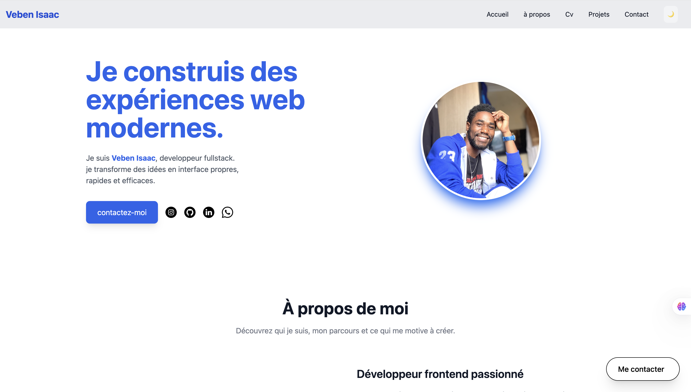

# Portfolio professionnel — Veben Isaac

🔗 **[Voir le site en direct](https://incandescent-banoffee-32adb2.netlify.app/)**


Bienvenue sur le dépôt de mon portfolio.

Ce site a été bâti avec une approche **Mobile First** et une architecture **Git Flow** rigoureuse pour garantir une qualité de code professionnelle.

## 🖼️ Aperçu



## Pages incluses

- **Accueil** — une introduction dynamique présentant mon profil et mes objectifs
- **À propos** — le récit de mon parcours, de la précision du dessin au crayon à la logique du code
- **Projets** — une galerie de mes réalisations web (SunnySide, Burger Website, Coffee Shop)
- **CV** — un résumé détaillé de mes compétences techniques, de mes qualités (discipline, autonomie...) et de mes projets, avec téléchargement en PDF
- **Contact** — un point d'entrée direct pour les collaborations, avec formulaire dédié et mes réseaux sociaux

## Stack technique

- **Structure** : HTML5 sémantique pour un SEO et une accessibilité optimisés
- **Style** : Tailwind CSS pour une interface moderne, rapide et entièrement responsive
- **Interactivité** : JavaScript pour la gestion du menu mobile, du mode sombre et des animations fluides
- **Design** : conception de maquette haute fidélité sur Figma
- **Versionnage** : utilisation stricte de Gitflow (branches `main`, `develop` et `feature/*`)

## Fonctionnalités clés

- Design responsive : adaptation sur tous les écrans (mobile, tablette, desktop)
- Mode sombre / clair avec mémorisation de la préférence (localStorage)
- Bouton d'action flottant pour contacter rapidement (email, WhatsApp, appel)
- Transitions et effets de survol (hover) pour une expérience utilisateur soignée
- Historique de commits granulaire montrant l'évolution étape par étape du projet

## 📁 Structure du projet

```
portfolio/
├── index.html         # Accueil
├── apropos.html       # À propos
├── CV.html             # CV interactif + PDF téléchargeable
├── projets.html        # Galerie de projets
├── Contact.html         # Formulaire de contact
├── images/              # Photos, icônes, miniatures de projets
├── documents/            # CV au format PDF
├── LICENSE
└── README.md
```

## Lancer le projet en local

Aucune installation ni dépendance requise : le projet est un ensemble de pages statiques.

1. Clone le dépôt
   ```bash
   git clone https://github.com/veben-cmyk/portfolio.git
   cd portfolio
   ```
2. Ouvre `index.html` dans ton navigateur, ou utilise une extension type *Live Server* (VS Code) pour le rechargement automatique.

##  Workflow Git (Gitflow)

| Branche | Rôle |
|---|---|
| `main` | Code stable, en ligne |
| `develop` | Branche d'intégration des nouvelles fonctionnalités |
| `feature/*` | Une branche par page/fonctionnalité (ex: `feature/cv-page`) |
| `fix/*` | Correction de bug isolée |

Convention de commit : [Conventional Commits](https://www.conventionalcommits.org/) (`feat:`, `fix:`, `style:`, `docs:`, `refactor:`...).

## Pistes d'amélioration

- [ ] Formulaire de contact fonctionnel (envoi réel des messages)
- [ ] Filtrage/recherche dans la galerie de projets
- [ ] Version anglaise du site

## 👤 Auteur

**Veben Isaac**
- Email : ciceronvben@gmail.com
- GitHub : [@veben-cmyk](https://github.com/veben-cmyk)
- LinkedIn : [Isaac Veben](https://www.linkedin.com/in/jaden-vben-6ab4093a9/)


## Licence

Ce projet est sous licence MIT — voir le fichier [LICENSE](LICENSE) pour plus de détails.
